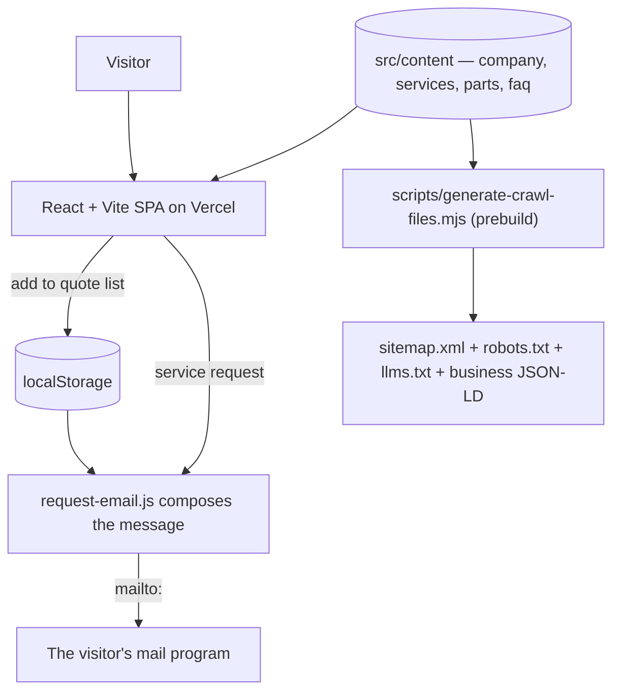

<p align="center">
  
</p>

<h1 align="center">Compound Industrial Scale Services</h1>

<p align="center">
  <b>Scale calibration, repair, and a parts counter that quotes against your equipment.</b>
</p>
<p align="center">
  The site for Compound Industrial Scale Services Inc.<br />
  Live at <a href="https://ccscaleservices.com">ccscaleservices.com</a>, moving to
  <a href="https://ccscaleservicesinc.com">ccscaleservicesinc.com</a>.
</p>
<p align="center">
  <sub>Published for reading. Proprietary — see <a href="LICENSE.md">LICENSE.md</a>. Outside contributions are not accepted.</sub>
</p>

<p align="center">
  
  
  
  
  
  
</p>

<br />

## Why Compound Industrial Scale Services

A customer arrives with a scale that's reading wrong or a part that's failed, and they need either a technician or a price.

The site answers both without a backend: services and parts are pages a search engine can index, and both request paths compose an email in the visitor's own mail program.

### A quote list, not a checkout

Parts collect in a list held in the browser, each carrying the make, model, and capacity of the scale it is for. One message reaches sales with everything needed to price it.

### No server, no database

Forms hand a composed message to the visitor's mail program, and the quote list lives in localStorage. There's no server-side data to secure.

### A page per part

Every catalog entry is its own indexable URL with structured data, which is what someone searching a symptom or a component name lands on.

### Content without a CMS

Services, parts, questions, and every business fact are five files under `src/content`. Adding a part is a data edit.

<br />

## Stack

| Layer | Technology |
| :--- | :--- |
| UI | React 19 + React Router 7 |
| Build & dev | Vite 7 |
| Styling | Tailwind CSS 3 + PostCSS |
| Icons | `lucide-react` |
| Type | Inter and Archivo, self-hosted from `public/fonts` with metric-matched local fallbacks |
| Content | Plain JS modules under `src/content` |
| Theming | CSS custom properties in `src/index.css`, three themes, Tailwind reads the same tokens |
| SEO | Per-route meta and JSON-LD from `src/lib`; sitemap, robots.txt, llms.txt, and the business JSON-LD generated at `prebuild` |
| State | React context over `localStorage` for the quote list and the theme choice |
| Backend | None — requests leave as `mailto:`; the one function under `api` reports the deployed commit |
| Telemetry | A page-view counter and an error reporter, both in `index.html` |
| Hosting | Vercel |

## Getting started

```bash
npm install
npm run dev           # Vite dev server on port 5173
npm run build         # regenerate the crawl files, then build to dist/
```

No environment configuration is required to run the site locally. `VITE_SITE_URL` is the one variable the project reads, it is documented in `.env.example`, and it only matters in a deployed environment — see [Which domain the site claims](#which-domain-the-site-claims).

### Scripts

| Script | Does |
| :--- | :--- |
| `npm run dev` | Start the Vite dev server on port 5173. |
| `npm run build` | Regenerate the sitemap, robots.txt, llms.txt, and the business JSON-LD, build to `dist/`, then write the stylesheet into the built `index.html`. |
| `npm run preview` | Serve the production build. |
| `npm run lint` | Lint with ESLint. |
| `npm run lint:fix` | Lint and auto-fix. |
| `npm run format` | Format `src/**` with Prettier. |
| `npm run format:check` | Check formatting without writing. |

## Architecture



## How it works

- **Content is the database.** Five modules under `src/content` hold every fact the site states — the business details, the five services, the part categories, the parts catalog, and the home-page questions. Pages, structured data, and the sitemap all read from the same modules, so a fact is stated once.
- **A request is an email, not a POST.** `src/lib/request-email.js` composes both the quote and the service message and hands it to the visitor's mail program. The plain text is built separately from the `mailto:` link so the request page can show it on screen — a machine with no mail client configured still leaves the visitor something to copy.
- **The quote list carries context.** Each line holds the make, model, and capacity of the scale the part is for, so one message reaches sales with enough to price it without a follow-up.
- **Every part is an indexable URL.** The catalog, the detail route, and the sitemap are all driven off `parts.js`, and each entry gets `Product` and `Breadcrumb` structured data alongside the `LocalBusiness` and `Service` blocks.
- **Colour is a token, not a value.** `src/index.css` holds three layers: the two logo ramps as primitives, semantic names for what a value is for, and the component classes that consume them. A theme is a block of semantic values and nothing else, which is what lets light, dark and gray share one set of components. The Tailwind theme reads the same custom properties rather than holding a second palette.
- **Nothing about a customer is stored server-side.** The quote list and the theme choice live in `localStorage`, and the forms hold no data after the message leaves, so there is no customer record to secure. Two scripts in `index.html` do leave the page: a page-view counter and an error reporter, both described on the privacy page.

## Project structure

```
ccscaleservicesinc-com/
├── api/
│   └── version.js             Reports the commit the running deployment was built from
├── public/
│   ├── brand/                 Logo, mark, Open Graph image
│   ├── photos/                Service photography
│   ├── fonts/                 Inter and Archivo, self-hosted as variable WOFF2
│   ├── sitemap.xml            Generated by prebuild — edit the script, not this
│   ├── robots.txt             Generated by prebuild
│   └── llms.txt               Generated by prebuild
├── scripts/
│   ├── generate-crawl-files.mjs   Reads the content modules, writes the crawl files, syncs the business JSON-LD and the shell's nav destinations in index.html
│   └── first-screen.mjs       Runs after the Vite build, writing the stylesheet into dist/index.html so the first screen waits on no other file
├── src/
│   ├── content/               Everything the site states as fact
│   │   ├── company.js         Name, emails, phone, address, hours, credentials
│   │   ├── services.js        The five services, their detail and their slugs
│   │   ├── part-categories.js The six groups the catalog is filed under
│   │   ├── parts.js           The catalog and the search over it
│   │   └── faq.js             Questions answered on the home page
│   ├── lib/
│   │   ├── seo.js             Per-route title, meta, canonical, and JSON-LD
│   │   ├── structured-data.js LocalBusiness, Service, Product, Breadcrumb, FAQ blocks
│   │   ├── request-email.js   Composes the quote and service request messages
│   │   ├── contact-form.js    The shared contact fields, their rules, and their messages
│   │   ├── theme.js           Reads, applies, and stores the light/dark/gray choice
│   │   ├── quote-context.js   The quote list context and its hook
│   │   ├── chunk-recovery.js  Reloads a tab still holding a build the host has replaced
│   │   ├── icon-size.js       The three sizes an icon is drawn at
│   │   └── local-time.js      The company's own clock, which the footer's year is read on
│   ├── components/
│   │   ├── layout/            The frame every page is drawn inside: Header and its panels, ActionRail, Footer, ThemeToggle, Wordmark
│   │   ├── sections/          Blocks a page composes: PageHeader, CallToAction, PartCard
│   │   ├── forms/             The shared field kit: FormField, ContactFields, FormErrorSummary
│   │   └── app/               What App.jsx mounts around the routes: QuoteProvider, ScrollToTop, ClickSpark, RouteFallback
│   ├── index.css              The token layer, the base states, and the component classes
│   ├── pages/                 One file per route
│   ├── App.jsx                Route table, every page but the home page behind its own chunk
│   └── main.jsx               Browser entry
└── vercel.json                SPA rewrite for cold loads, and how long each asset caches
```

## Editing content

Adding a part means appending an object to `parts` in `src/content/parts.js`. It needs a `slug`, a `category` matching one in `partCategories` in `src/content/part-categories.js`, a `summary`, a `description`, an `askFor` list of what a quote needs, and `keywords` for the on-site search. The catalog page, the detail route, and the sitemap all pick it up from there.

A `slug` is a public URL. Add and retire them; renaming one breaks whatever already links to it.

### Capitalization

Two cases, split by what the text does:

- **Title Case** for anything that names a thing or an action: buttons, nav items, form labels, tabs, card titles, and the `name` field on every service, part, and category. "Add to Quote", "Shear Beam Load Cell", "Where to Send the Quote". Articles, coordinating conjunctions, and short prepositions stay lowercase unless they open or close the label.
- **Sentence case** for anything that reads as a sentence: page headlines, body copy, list items, the hint under a field, and the `summary` and `description` fields.

A `name` renders as a button on the catalog page and as an `h1` on the part page, which is why it's cased once at the source instead of at each call site.

## Before launch

`src/content/company.js` is the checklist. A field left empty is hidden rather than rendered blank, so the site works while it is incomplete. The phone number and the street address are in; these are the fields still empty, and each is something a customer looks for:

- **Hours:** `{ days, hours }` pairs, shown in the footer.
- **Service area:** the counties and metros the techs drive to, shown on the About page.
- **Credentials:** certifications and licenses, each one live at the time it goes in.
- **Founding year:** the "since" line on the About page, and the structured data.
- **Social profile URLs:** each one renders an icon in the footer once the account is claimed.

The service and parts copy in `src/content` describes the work in general terms. Read it against how the company actually operates before it goes live.

## Deployment

Vercel, building from `main`. `vercel.json` rewrites every path to `index.html` so a client-side route resolves on a cold load, and the defaults Vercel detects for a Vite project are the right ones:

| Setting | Value |
| :--- | :--- |
| Framework preset | Vite |
| Build command | `npm run build` (runs `prebuild` first) |
| Output directory | `dist` |
| Install command | `npm ci` |
| Node version | 22, from `engines` in `package.json` |

### How long each asset caches

Without a `Cache-Control` of its own, Vercel serves a file as `max-age=0, must-revalidate`, so every view of every page goes back to the network for the whole bundle and every photo. `vercel.json` sets four policies instead:

| Path | Policy | Why |
| :--- | :--- | :--- |
| `/assets/*` | one year, `immutable` | Vite puts a content hash in the filename, so a changed file is a new URL |
| `/brand/*`, `/photos/*` | one hour, then a week of `stale-while-revalidate` | The filenames are stable, so a replaced photo has to be able to reach a returning visitor |
| `/fonts/*` | one year, `immutable` | The two woff2 files are 83KB the browser would otherwise revalidate on every visit; the year is what makes a re-subset font a new filename rather than an edit in place |
| The icons and the manifest | the same hour and week | Same reason, and the same fixed names: `favicon.ico`, `favicon.svg`, `apple-touch-icon.png`, `site.webmanifest`, and the four PNG icons |
| Everything else | Vercel's default | `index.html` carries the current asset hashes and has to be re-read on every visit for a deploy to land |

A photo swapped in under its old name shows up within the hour, and sooner for anyone who has not been to the site that day.

### Which domain the site claims

`VITE_SITE_URL` sets the origin used by canonical tags, Open Graph URLs, the sitemap, the structured data, and the `Sitemap:` line in robots.txt. Unset, it falls back to `https://ccscaleservices.com`.

It has to name the domain visitors actually land on. A canonical tag pointing at a domain that doesn't serve the page tells a crawler to index that other domain instead, and the live pages drop out of results.

Moving the site to `ccscaleservicesinc.com` later is one environment variable and a redeploy:

```bash
vercel env add VITE_SITE_URL production
```

Set it to `https://ccscaleservicesinc.com`, redeploy, then add the old domain to the project as a redirect so the links and search ranking built up in the meantime follow along.

## License

Copyright (c) 2026 TaylorURL LLC. All rights reserved. See [LICENSE.md](LICENSE.md).

<br />

<p align="center">
  <sub>Scale calibration, repair, and parts for the upper Texas Gulf Coast.</sub>
</p>
